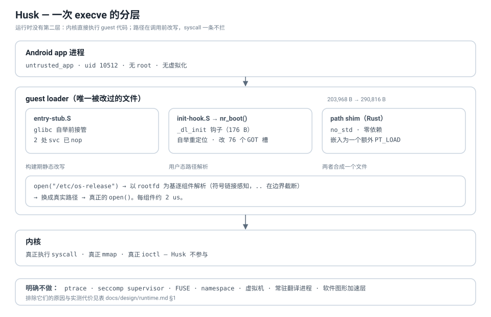

<!-- 首屏只放标题、图标和徽章。GitHub 只在空行处结束 HTML 块，各段必须分开，
     否则标题会退回左对齐。项目介绍从下面的「概览」开始。 -->
<h1 align="center">Husk</h1>

<p align="center">
  
</p>

<p align="center">
  <a href="https://github.com/xishanp/Husk/releases"></a>
  <a href="https://github.com/xishanp/Husk/actions/workflows/ci.yml"></a>
  <a href="LICENSE"></a>
  
  
  <a href="CONTRIBUTING.md"></a>
</p>

## 概览

让 Linux 用户态以普通应用进程的身份，直接跑在 Android 内核上。

Husk 在 Android 上跑一棵真实的 Linux 用户态：glibc、包管理器、编译器、shell 和服务都是普通
`untrusted_app` 进程，直接向 Android 内核发系统调用。路径改写只在装载时做一次（改每个对象
的 GOT），之后程序自己的 `svc` 指令原样进内核，每条 syscall 的成本与原生应用相同；沙箱放行
的设备节点可以直开。没有 namespace，没有虚拟机，也不跑 `ptrace`。

运行时按 glibc 版本断言补丁点，不绑定某个发行版或某台设备。本次完整验证用的是 Ubuntu 24.04
（glibc 2.39）和一台 arm64 Android 手机；型号、内核与每一条实测数字写在
[`docs/STATUS.md`](docs/STATUS.md) 与 `docs/design/evidence/`，那只是实测条件，不是要求。

## 唯一有效宿主

Husk 是**运行时**，不是 App。它被一个宿主 App 装进自己的数据目录，并由宿主提供窗口系统、
输入注入和 Surface 呈现。当前唯一有效宿主是 **LinuxHub 2.0 的 Husk 运行时**
（包名 `com.linuxhub.myth.husk`）。

> [!WARNING]
> 更早有一批结论是在**另一个应用**（`com.linuxhub.husk`）里测的，宿主层不同，那些数字
> 一律作废，不要引用。仓库里凡是保留的旧现场记录，都注明了"旧宿主现场"。

对外唯一的交付物是运行时包 `dist/husk-arm64.tar.gz`；宿主 App 怎么起桌面、怎么合成窗口，
不属于本仓库。

## 现在能做什么

判据只有一条：**驱动能加载、element 能注册、编译能通过，都不算"能用"。** 只认设备上实测到
的最终行为。每行右边的证据都是设备原始输出。

| 能力 | 状态 | 证据 |
|---|---|---|
| 安装器 `--upgrade` + 运行身份自证 | PASS（12/12，六项 SHA 与包内记录一致） | `367-runtime-upgrade-20261128` |
| ICD canonical、旧 ICD 全部禁选 | PASS=15 | `367-gpu-audit-final-20261128` |
| GPU 全局继承 13 项 | PASS=3（gnome-shell / nested GTK 均 zink + 硬件 Vulkan + `/dev/mali0`） | 同上 |
| 读回 2400×1080 | PASS=19 | 同上 |
| 4 路 × 300 s GPU soak | PASS（fd 7→7，RSS +244 kB，errors=0） | `367-gpu-soak-final-20261128` |
| A-hw：相机/麦克风/传感器/定位权限与数据 | PASS=15 | `367-a-hw-final-20261128` |
| 桌面会话、139 崩溃 | PASS（20 s 无 139） | `367-snapshot-final-20261128` |
| 相机预览 | **FAIL**：能出画面，但逐帧刷新、帧率极低，未达可用 | 现场反馈，待量化 |
| 视频（标准 VA-API 路径 / 桌面播放器） | **FAIL**：720p 通；1080p 与 High profile 12–25 帧后停摆 | `367-video-va-ab-20261128` |
| 视频（Husk 自有 SurfaceControl 路径） | PASS：H.264 1080p30 连续 600 s，`dropped=0` | `80-video-1080p30-10min` |

写 FAIL 的两行不是没做，是做了且没达标——照实写，不藏。

## 能跑起来的前提

> [!IMPORTANT]
> **这一节只讲一件事：它怎么才能跑起来。三条硬前提，缺一条就跑不起来；其它条件只影响跑得
> 多完整，不影响能不能跑。** 逐条的自查方式与原因在 [`docs/RUNNING.md`](docs/RUNNING.md) §2。

| # | 硬前提 | 不满足时的样子 | 怎么自查 |
|---|---|---|---|
| 1 | **arm64（aarch64）**：用户态是 aarch64 ELF，loader 的 GOT 改写与 syscall 直通只对这一个 ABI 成立 | 直接 `Exec format error` | `uname -m` → `aarch64` |
| 2 | **一个既能执行、又可写、沙箱也允许的目录**：loader 与用户态二进制都要被 `exec`。Android 上只有应用私有目录满足；`noexec` 挂载直接失败 | 看起来像 loader 坏了：`cannot execute the loader from here` | 直接跑 loader，它应回 `missing program name`（说明 `exec` 成功） |
| 3 | **系统没有对 `untrusted_app` 额外收紧 seccomp / SELinux**：用户态要 `execve` / `clone` / `open*` 直通内核；厂商另封一层就没有可绕的余地 | `Bad system call`，进程当场被杀 | 先跑 `bin/true`；或跑 `tools/device-tests/01-functional-matrix.sh` |

```sh
# 1、2：loader 自己能不能被 exec —— 期望输出 missing program name
cd files/linux/husk && ./libld.so

# 2、3：guest 程序能不能直通内核 —— 期望退出码 0
sh husk-session.sh files/linux/distributions/<发行版>/rootfs -- /usr/bin/true
```

## 目录

- [概览](#概览) · [唯一有效宿主](#唯一有效宿主) · [现在能做什么](#现在能做什么)
- [能跑起来的前提](#能跑起来的前提) · [为什么是 Husk](#为什么是-husk)
- [特性](#特性) · [和容器、虚拟机的区别](#和容器虚拟机的区别)
- [硬件接口](#硬件接口) · [交付形态](#交付形态)
- [工作原理](#工作原理) · [从源码构建](#从源码构建)
- [仓库结构](#仓库结构) · [文档](#文档) · [常见问题](#常见问题)

## 为什么是 Husk

同一台手机、同一份 rootfs、同一个 workload，只换运行器。下表是 **2026-11-24 的五轮轮转
中位数**，采于旧宿主层：

| 工作量 | Husk | proot | 倍率 |
|---|---:|---:|---:|
| `stat` × 20 000 | 650 ms | 3 734 ms | **5.7×** |
| `open` + `close` × 20 000 | 1 252 ms | 8 481 ms | **6.8×** |
| `make -j4`，200 目标链接 | 5 194 ms | 24 182 ms | **4.7×** |
| 顺序写 256 MB | 1 294 ms | 1 321 ms | 1.0× |

> [!NOTE]
> 这组数字是旧宿主现场。**方向可信**（优势随路径/syscall 密度放大，大块 IO 上消失），
> **具体数值在新宿主上重跑之前不作承诺**。机制、代价与完整八维表见
> [`docs/BENCHMARKS.md`](docs/BENCHMARKS.md)。

## 特性

- **零 `ptrace`、零 syscall 拦截。** 内核看到的是用户态自己的 syscall。
- **原样的 glibc 用户态。** 除 libc 内部调用需要的 slot 项，树的二进制没有为 Husk 改过。
- **包管理器可用。** `apt-get install` 27 秒把树从 815 包装到 882 包，含 `build-essential`、
  `nodejs`、`python3-numpy`。
- **工具链完整。** `gcc`、200 目标工程的 `make -j4`、`git clone`、`python3` + `numpy`。
- **系统服务可用。** dbus、polkit、at-spi、gvfs 与 RandR 能在 Linux 用户态里直接启动；
  它们是否需要桌面会话由宿主决定。
- **不需要任何特权。** 跑在普通应用沙箱里，机器可以是原厂状态。
- **GPU 默认值在加载器里，不在登录脚本里。** 非登录执行、嵌套 `exec` 和 `env -i` 也不会
  掉回软件渲染；程序自己设的变量永远优先。
- **对比可以自己重跑。** `tools/bench/` 一条命令把同一份 rootfs 交给三个运行器。

## 和容器、虚拟机的区别

| | 传统容器 | 虚拟机 | PRoot 一类 | **Husk** |
|---|---|---|---|---|
| 内核 | 宿主内核（要 namespace/cgroup） | 自带内核 | 宿主内核 + `ptrace` | **宿主内核，零拦截** |
| 权限 | root / user namespace | 虚拟化 | 普通应用 + `ptrace` | **普通应用** |
| 每条 syscall 成本 | 原生 | 陷入虚拟机 | 一次 `ptrace` 往返 | **原生（0 额外）** |
| 路径隔离 | mount namespace | 完整隔离 | `ptrace` 逐条改写 | **装载时改 GOT，一次到位** |
| 设备访问 | 受 namespace 限制 | 虚拟设备 | 受 `ptrace` 限制 | **能直开的直开，其余走应用内后端** |

一句话：容器和虚拟机都是「把用户态装进一个边界」，Husk 是「让用户态自己跑，只在装载时把
路径改对一次」。所以它既不需要特权，也不为每条 syscall 付费。

> [!WARNING]
> **Husk 不是恶意代码沙箱。** 路径改写只覆盖「经过动态链接函数入口」的调用：自己发 raw
> `syscall` 的程序、静态链接的二进制、以及不经我们 loader 启动的进程，看到的都是宿主路径。
> 它能把普通 Linux 用户态按普通应用权限跑起来，**不能**用来隔离不可信的代码。

## 硬件接口

能直接用的内核节点直接交给 guest；必须经过 Android 应用身份的能力，提供标准 Linux 接口，
并明确标注为 facade 或中转。

| 能力 | 接法 | 用户态接口 | 当前验收 |
|---|---|---|---|
| GPU | **直连** | `/dev/mali0`，PanVK + Zink | Mali-G77 枚举、compute、离屏 graphics、EGL/GL 均通过；默认环境由 loader 注入。Adreno/KGSL 无真机证据，状态 UNKNOWN |
| 相机 | **中转** | 标准 V4L2 `/dev/videoN` facade | 前后摄可启动，`read`/`readv`/`mmap`/拍照/录像的数据链通过。桌面预览**能看到画面但逐帧刷新、帧率极低，未达可用**。`open()` 返回 memfd，非真实 V4L2 fd；DMABUF 与 controls 未支持 |
| 音频 | **中转** | PulseAudio → Rust relay → AAudio | 输出与采集均有真实 PCM 数据（采集实测 200704 B，peak=1891）；`/dev/snd` 在应用域不可直接打开 |
| 视频解码 | **中转** | VA-API → Rust bridge → MediaCodec | 两条路径分开看：自有 SurfaceControl 路径 1080p30/600 s `dropped=0`；**标准 VA-API 路径只有 720p 通过**，1080p 与 High profile 停摆 |
| 传感器 | **中转** | IIO sysfs 影子树 ← NDK `ASensorManager_*` | 加速度、磁力、陀螺仪、环境光、距离五类可读，三套 IIO 视图一致 |
| 定位 | **中转（仅 last-known）** | gpsd JSON over Unix socket ← `LocationManager` | `VERSION`/`DEVICES`/`WATCH`/`POLL`/`TPV` 已通，实测 `mode=3`；持续定位与 GNSS 原始测量未验证 |
| 显示 | **应用侧中转** | `AHardwareBuffer` → dma-buf → `SurfaceControl` | 应用侧接管段为零拷贝；窗口内容进宿主 X server 仍是回读与 SHM 拷贝 |

口径：**GPU 是直连；相机、音频、视频、传感器、定位是中转；显示只在其应用侧接管段为零拷贝。**
USB 与蓝牙仍需最小 Java 回调垫片；NFC 与指纹对 Linux 用户态不是必需的设备接口。逐项理由与
被宿主拒绝时的原始错误串见
[`docs/design/hardware-interface-map.md`](docs/design/hardware-interface-map.md)。

GPU 默认值属于运行时接口的一部分：ICD、GL 驱动和 GLES 上限写在 `/etc/husk/gpu-env`，由
loader 在程序没有显式设置时注入；Mali/kbase 的 PanVK 快照随包安装，安装器校验设备节点与
驱动 SHA-256。

## 交付形态

> [!IMPORTANT]
> **这些资产不能脱离应用沙箱直接用在别的终端环境里。** 别的环境没有这套依赖，也没有
> 「可写 + 可执行 + 沙箱允许」三者同时成立的目录。交付形态只有一种：打进 APP。

宿主 App（LinuxHub 2.0 的 Husk 运行时）持有 X server、做输入注入、负责 Surface 呈现；
`dist/husk-arm64.tar.gz` 不内嵌 X server，也不含桌面合成器。

```text
APK assets/husk/arm64-v8a/
  libld.so          loader（内嵌 path-shim）
  libc.so.6         打过两处补丁的 glibc
  husk-ldconfig     写 ld.so.cache 与 ld.so.husk-path
  husk-usermgr      useradd / groupadd / passwd 一族替身
  husk-su           提权替身
  husk-symlinks     绝对符号链接改相对 + 校验（否则 dlopen 找不到明明存在的库）
```

首次启动自动完成：解压 loader → 放三个工具进 `usr/sbin` → 按 sha256 替换 libc（只认已知
基线）→ `ldconfig` 指向 `husk-ldconfig` → shadow 工具指向 `husk-usermgr` → 建
`run` / `tmp` / `dev/shm` → 写版本标记 `files/linux/husk/assets.version`。

会话启动契约（缺一个就看起来像 shim 坏了）：

```sh
NR_ROOTFS=<rootfs> NR_LD=<loader> NR_LIBRARY_PATH=<lib/aarch64-linux-gnu:usr/lib/...> \
  <loader> --library-path "$NR_LIBRARY_PATH" usr/bin/env -i PATH=... HOME=/root /bin/sh
```

装上发行版之后**必须改的 7 件事**见 [`docs/RUNNING.md`](docs/RUNNING.md)。

开发机上不装 APP 也能跑（`/data/local/tmp` 之类可执行的目录），这是调试路径，不是交付形态：

```sh
adb push husk-arm64.tar.gz /data/local/tmp/husk/
adb shell
cd /data/local/tmp/husk && tar xzf husk-arm64.tar.gz
sh install-husk.sh --rootfs linux-rootfs.tar --dest ./root --loader ./libld.so
./husk run linux
```

## 工作原理

<p align="center">
  
</p>

Android 唯一执行的是一个静态 loader，path-shim 内嵌在里面。它映射用户态对象时改写该对象的
GOT，让每个 libc 路径调用落到 shim；shim 加一次根前缀，然后发真正的 syscall。`exec` 由
loader 自己解析（含 `PT_INTERP` 与 shebang），嵌套 exec 会重新回到同一个 loader，而不是掉回
宿主。因为此后没有任何东西挡住进程，程序从第一条指令起，syscall 就是原生的。细节见
[`docs/ARCHITECTURE.md`](docs/ARCHITECTURE.md)。

## 从源码构建

> [!WARNING]
> `make test` 会编译 aarch64 内联汇编，只有在 arm64 Linux 主机上能跑；在 macOS / x86_64 上
> 编译不过，那是平台限制，不是补丁坏了——那边用 `make check`。

```sh
# loader（需要 NDK；会断言它补丁的 glibc 版本）
NDK=$ANDROID_HOME/ndk/<ver>/toolchains/llvm/prebuilt/<host>/bin \
  sh tools/loader/build-embedded-loader.sh

# Rust crates（no_std shim + 宿主工具）
cargo build --release --manifest-path runtime/Cargo.toml

# 本地门禁：CI 把同一组命令拆成七个作业跑，任何一个红了就不算过
make check   # fmt + aarch64 cargo check + clippy + shell 语法 + 文档链接 + 版本三元组

# 出运行时包（只发这一种资产）
NDK=<ndk>/bin make dist
```

## 仓库结构

```
runtime/crates/      loader 侧的 path-shim、exec、PTY、信号（Rust，no_std）
runtime/crates/nr-tools/  ELF 手术：scan、patch、embed、libc interpose
tools/loader/        入口与 hook 汇编，产出 loader 的构建
tools/bench/         产出 docs/BENCHMARKS.md 的三运行器夹具
tools/guest/         rootfs 安装器、会话脚本、release 打包（不需要 APK）
tools/guest-config/  libc 补丁、ldconfig、符号链接改写
tools/device-tests/  设备验收套件，含门禁 A / A-hw
docs/design/evidence/  文档里每个数字背后的设备原始输出
```

## 文档

| 文档 | 回答什么 |
|---|---|
| [`docs/ARCHITECTURE.md`](docs/ARCHITECTURE.md) | loader、shim、exec 图怎么拼起来 |
| [`docs/BENCHMARKS.md`](docs/BENCHMARKS.md) | 对比、机制、代价 |
| [`docs/RUNNING.md`](docs/RUNNING.md) | 怎么装怎么跑，含 rootfs 准备三步 |
| [`docs/COMPATIBILITY.md`](docs/COMPATIBILITY.md) | 每个运行器能跑什么 |
| [`docs/design/hardware-interface-map.md`](docs/design/hardware-interface-map.md) | 每类硬件怎么接：直连 / 中转 / 不需要 / 权限或厂商限制 |
| [`docs/LIMITATIONS.md`](docs/LIMITATIONS.md) | 什么不工作，为什么 |
| [`docs/STATUS.md`](docs/STATUS.md) | 目标机上的当前状态 |
| [`docs/RESULTS.md`](docs/RESULTS.md) | 门禁与实测结果汇总 |
| [`docs/design/DEVLOG.md`](docs/design/DEVLOG.md) | 1.0 之前的工程日记 |
| [`CONTRIBUTING.md`](CONTRIBUTING.md) | 怎么构建、怎么测、术语表 |
| [`ROADMAP.md`](ROADMAP.md) | 对外承诺：交付了什么、下一步、不做什么 |
| [`SECURITY.md`](SECURITY.md) | 什么算漏洞、怎么私密上报 |

## 常见问题

**需要 root 或解 Bootloader 吗？** 不需要。跑在 `untrusted_app` 里，能碰到的东西就是应用
沙箱允许的那些。

**这是容器还是虚拟机？** 都不是。同一个内核，没有 namespace、没有 cgroup、不模拟任何指令。
用户态就是一棵普通进程树。

**为什么 `apt-get update` 只快 1.1×？** 因为它受镜像和 dpkg 自身的工作限制，不取决于路径
查找。基准照实写。

**能跑 Debian / Fedora / Alpine 吗？** 只完整验证过参考发行版（glibc 的 Ubuntu 24.04）。
Alpine 是 musl，是另一个问题；装载器的补丁是版本断言的，换树要重新验证。

**为什么 rootfs 要打补丁？** 两个 Android 特有缺口：libc 内部调用需要 slot 项；rootfs 里的
绝对符号链接会按 Android 根解析。步骤在 `docs/RUNNING.md`，工具在 `tools/guest-config/`。

> [!CAUTION]
> **能在 Termux 里跑吗？不能，也不支持。** Termux 的 `$PREFIX` 不提供这里需要的二进制与库，
> 在那边跑会直接卡在缺依赖上。

**验证过哪些 Android 与内核？** 当前宿主是 LinuxHub 2.0 的 Husk 运行时
（`com.linuxhub.myth.husk`），参考环境是 Android 13、kernel 4.19.191、4 KiB 页、arm64。
16 KiB 与 64 KiB 页只在 QEMU 上跑过。这不是要求，是实测条件。

**为什么 README 里有 FAIL？** 因为那些能力现在真的没过。驱动能加载、element 能注册、编译能
通过，都不写进"能用"。

## 参与贡献

欢迎 issue 与 pull request；先读 [`CONTRIBUTING.md`](CONTRIBUTING.md)。注意：每个性能结论
都要有一个 `docs/design/evidence/` 下的证据文件。本项目遵循
[Contributor Covenant 2.1](CODE_OF_CONDUCT.md)。安全问题见 [`SECURITY.md`](SECURITY.md)。

## 许可

Apache License 2.0，见 [LICENSE](LICENSE)。第三方组件、glibc 构件与商标声明见
[NOTICE](NOTICE)。

## 致谢

`docs/BENCHMARKS.md` 里的对比是靠运行 [proot](https://proot-me.github.io/) 与 proot-distro
得到的——它们曾是 LinuxHub 2.0 的运行时，这些数字存在是因为它们能用。loader 的补丁针对的
是 Android 的 Bionic 与 bionic 化的 libc 边界，与它们的实现没有关系。
