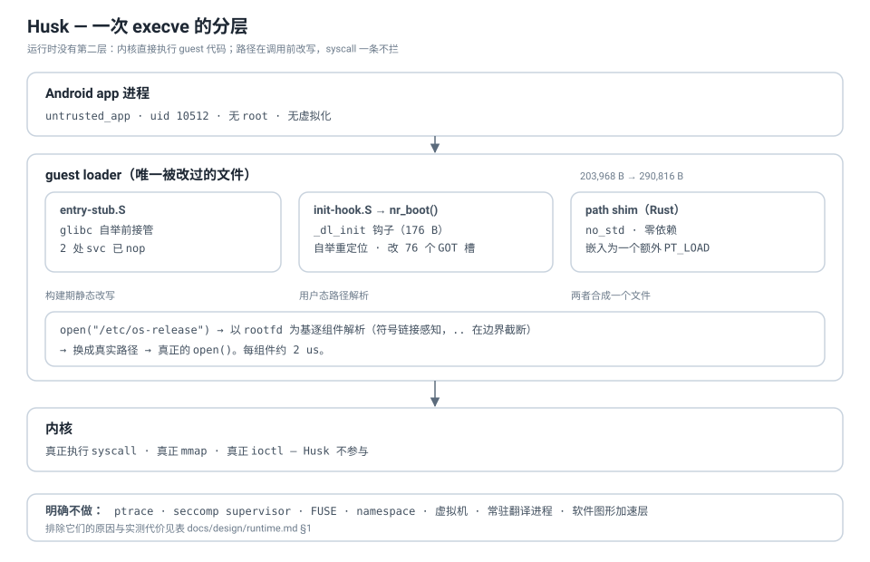

<!-- 首屏：标题一行，图标下一格。GitHub 只在空行处结束 HTML 块，两段必须分开，
     否则标题会退回左对齐。 -->
<h1 align="center">Husk</h1>

<p align="center">
  
</p>

<p align="center">让完整的 Linux 发行版以普通应用进程的身份，直接跑在 Android 内核上。</p>

<p align="center">
  <a href="https://github.com/xishanp/Husk/releases"></a>
  <a href="LICENSE"></a>
  
  
  <a href="CONTRIBUTING.md"></a>
</p>

<p align="center">
  <a href="README.md">English</a> · <b>简体中文</b> ·
  <a href="docs/ARCHITECTURE.md">架构</a> ·
  <a href="docs/BENCHMARKS.md">基准</a> ·
  <a href="CHANGELOG.md">更新记录</a> ·
  <a href="CONTRIBUTING.md">参与贡献</a>
</p>

Husk 是一个 Android 运行时：让未经改动的 glibc 用户态——带 `apt`、`gcc`、GNOME
Shell 的 Ubuntu 24.04——在普通的 `untrusted_app` 进程里跑起来。不需要 root、不需要
解 Bootloader、不需要硬件虚拟化，也不做 `ptrace`：路径虚拟化在装载时做一次（改写每个
对象的 GOT），之后程序自己的 `svc` 指令原样进 Android 内核。

## 目录

- [为什么是 Husk](#为什么是-husk) · [特性](#特性) · [快速开始](#快速开始)
- [工作原理](#工作原理) · [性能](#性能) · [兼容性](#兼容性)
- [限制](#限制) · [从源码构建](#从源码构建)
- [仓库结构](#仓库结构) · [文档](#文档)
- [常见问题](#常见问题) · [参与贡献](#参与贡献) · [许可](#许可)

## 为什么是 Husk

同一台手机、同一份 rootfs、同一个 shell，只换运行器。5 轮中位数，2026-11-24 实测
（[`docs/BENCHMARKS.md`](docs/BENCHMARKS.md)）：

| 工作量 | Husk | proot | 倍率 |
|---|---:|---:|---:|
| `open` + `close` × 20 000 | 1 252 ms | 8 481 ms | **6.8×** |
| `make -j4`，200 目标链接 | 5 194 ms | 24 182 ms | **4.7×** |
| 顺序写 256 MB | 1 294 ms | 1 321 ms | 1.0× |

前两行是路径与 syscall 密集的活，要付 proot 每条 syscall 的 `ptrace` 往返；第三行是
大块写，不经过被翻译的路径，所以打平——表里照写，不藏。

## 特性

- **零 `ptrace`、零 syscall 拦截。** 内核看到的是 guest 自己的 syscall（evidence 130–146）。
- **未改动的 glibc 用户态。** Ubuntu 24.04 / glibc 2.39；guest 树里除了 libc 内部
  调用用的 slot 项，没有为 Husk 改过的二进制。
- **能用的包管理器。** `apt-get install` 27 秒把 rootfs 从 815 包装到 882 包，含
  `build-essential`、`nodejs`、`python3-numpy`（evidence 154）。
- **完整工具链。** `gcc`、200 目标工程的 `make -j4`、`git clone`、`python3` + `numpy`
  （evidence 155）。
- **桌面。** GNOME Shell 46 的 X11 会话，顶栏 / dock / 壁纸 / 通知都在屏
  （evidence 147），触摸经 XI2 进 mutter（evidence 148）。
- **会话服务。** polkit 授权、at-spi 无障碍总线、gvfs、RandR 1.2 且无缩放告警
  （evidence 151、152）。
- **不需要任何特权。** 跑在普通应用沙箱里，机器可以是原厂状态。
- **对比可以自己重跑。** `tools/bench/` 一条命令把同一份 rootfs 分别交给 Husk、
  proot、proot-distro，原始日志在仓库里。

## 快速开始

需要：arm64 Android 设备（Android 8+）、`adb`、目标目录约 2.5 GB 空闲、一个 rootfs
压缩包。

```sh
# 1. 装启动器并展开 rootfs（不需要 APK，不需要 root）
adb push husk-arm64.tar.gz /data/local/tmp/husk/
adb shell
cd /data/local/tmp/husk && tar xzf husk-arm64.tar.gz
sh install-husk.sh --rootfs ubuntu-24.04-husk.tar --dest ./root --loader ./libld.so

# 2. 进 shell
./husk

# 3. 在 guest 里用包管理器
apt-get update && apt-get install -y vim
```

图形会话由 Android 应用集成（LinuxHub 2.0）启动：桌面步骤与"stock rootfs 的三步
准备"见 [`docs/RUNNING.md`](docs/RUNNING.md)。

## 工作原理

<p align="center">
  
</p>

Android 唯一执行的是一个静态 loader，path-shim 内嵌在里面。它映射 guest 对象时改写该
对象的 GOT，让每个 libc 路径调用落到 shim；shim 加一次 guest 根前缀，然后发真正的
syscall。`exec` 由 loader 自己解析（含 `PT_INTERP` 与 shebang），嵌套 exec 会重新回到
同一个 loader，而不是掉回宿主。因为此后没有任何东西挡住进程，程序从第一条指令起，
syscall 就是原生的。

细节见 [`docs/ARCHITECTURE.md`](docs/ARCHITECTURE.md)。

## 性能

八个维度、三个运行器、一台设备——汇总表在 [`docs/BENCHMARKS.md`](docs/BENCHMARKS.md)，
同页给出每个数字背后的机制和这套做法的代价。要点：优势随 syscall 与路径密度放大
（进程类 1.5×，路径类 3–7×），在大块 I/O 上消失。

## 兼容性

已在 Ubuntu 24.04 / glibc 2.39 / arm64 验证：`bash`、coreutils、`git`、`python3`
（+`numpy`）、`gcc`、`make`、`vim`、`nano`、`node`、`apt`、`dpkg`、GNOME Shell 46、
`nautilus`、`gnome-terminal`、`gnome-control-center`、dbus、polkit、at-spi、gvfs。
随附 rootfs 里没有浏览器。逐项矩阵（含每个运行器做不到什么）见
[`docs/COMPATIBILITY.md`](docs/COMPATIBILITY.md)。

## 限制

- ⚠️ 桌面是**软件渲染**（`swrast` / `llvmpipe`）。guest 的 GPU 通路存在，但还没接到 GNOME。
- ⚠️ 一个发行版、一个 ABI、一个设备族；loader 的补丁带版本断言，换 glibc 会直接报错，
  不会半好不坏地跑起来。
- ⚠️ stock rootfs 需要准备：libc 打补丁、绝对符号链接改相对、用 `husk-ldconfig`
  替换静态 `ldconfig`。
- 传感器、GPS、USB、蓝牙、NFC、指纹、硬件视频解码、WSI 均未实现。Termux 不是支持的环境。

完整清单与每条的证据：[`docs/LIMITATIONS.md`](docs/LIMITATIONS.md)。

## 从源码构建

```sh
# loader（需要 NDK；会断言它补丁的 glibc 版本）
NDK=$ANDROID_HOME/ndk/<ver>/toolchains/llvm/prebuilt/<host>/bin \
  sh tools/loader/build-embedded-loader.sh

# Rust crates（no_std shim + 宿主工具）
cargo build --release --manifest-path runtime/Cargo.toml

# CI 里跑的检查
make check   # fmt + aarch64 cargo check + clippy + shell 语法 + 文档链接
```

## 仓库结构

```
runtime/crates/    loader 侧的 path-shim、exec、PTY、信号（Rust，no_std）
runtime/crates/nr-tools/     ELF 手术：scan、patch、embed、libc interpose
tools/loader/      入口与 hook 汇编，产出 loader 的构建
tools/bench/       产出 docs/BENCHMARKS.md 的三运行器夹具
tools/guest/       rootfs 安装器与会话脚本（不需要 APK）
tools/guest-config/  libc 补丁、ldconfig、符号链接改写
tools/device-tests/  设备验收套件，含门禁 A
app-rs/, app/      Android 外壳（Rust Core + Kotlin 集成）
docs/design/evidence/  文档里每个数字背后的设备原始输出
```

## 文档

| 文档 | 回答什么 |
|---|---|
| [`docs/ARCHITECTURE.md`](docs/ARCHITECTURE.md) | loader、shim、exec 图怎么拼起来 |
| [`docs/BENCHMARKS.md`](docs/BENCHMARKS.md) | 对比、机制、代价 |
| [`docs/RUNNING.md`](docs/RUNNING.md) | 怎么装怎么跑，含 rootfs 准备三步 |
| [`docs/COMPATIBILITY.md`](docs/COMPATIBILITY.md) | 每个运行器能跑什么 |
| [`docs/LIMITATIONS.md`](docs/LIMITATIONS.md) | 什么不工作，为什么 |
| [`docs/STATUS.md`](docs/STATUS.md) | 目标机上的当前状态 |
| [`docs/design/DEVLOG.md`](docs/design/DEVLOG.md) | 1.0 之前的工程日记 |
| [`CONTRIBUTING.md`](CONTRIBUTING.md) | 怎么构建、怎么测、术语表 |

## 常见问题

**需要 root 或解 Bootloader 吗？** 不需要。跑在 `untrusted_app` 里，能碰到的东西就是
应用沙箱允许的那些。

**这是容器还是虚拟机？** 都不是。同一个内核，没有 namespace、没有 cgroup、不模拟任何
指令。guest 就是一棵普通进程树。

**为什么 `apt-get update` 只快 1.1×？** 因为它受镜像和 dpkg 自身的工作限制，不取决于
路径查找。基准照实写，不粉饰。

**能跑 Debian / Fedora / Alpine 吗？** 只验证过 glibc 的 Ubuntu 24.04。Alpine 是 musl，
是另一个问题；其余没跑过。

**桌面为什么是软件渲染？** 因为 GPU 通路还没接到 GNOME，见 `docs/LIMITATIONS.md` §1。
这与运行时的做法无关。

**为什么 rootfs 要打补丁？** 两个 Android 特有的缺口：libc 内部调用需要 slot 项；
rootfs 里的绝对符号链接会按 Android 根解析。步骤在 `docs/RUNNING.md`，工具在
`tools/guest-config/`。

**能在 Termux 里跑吗？** 不能，也不支持。guest 树需要的二进制与库 Termux 的 `$PREFIX`
不提供。

**验证过哪些 Android 与内核？** Android 13、kernel 4.19.191、4 KiB 页、arm64，一台设备
（RMX3357 / MT6893）。16 KiB 与 64 KiB 页只在 QEMU 上跑过。

## 参与贡献

欢迎 issue 与 pull request；先读 [`CONTRIBUTING.md`](CONTRIBUTING.md)。注意：每个性能
结论都要有一个 `docs/design/evidence/` 下的证据文件。本项目遵循
[Contributor Covenant 2.1](CODE_OF_CONDUCT.md)。安全问题见 [`SECURITY.md`](SECURITY.md)。

## 许可

Apache License 2.0，见 [LICENSE](LICENSE)。第三方组件、glibc 构件与商标声明见
[NOTICE](NOTICE)。

## 致谢

`docs/BENCHMARKS.md` 里的对比是靠运行 [proot](https://proot-me.github.io/) 与
proot-distro 得到的——它们曾是 LinuxHub 2.0 的运行时，这些数字存在是因为它们能用。
Ubuntu 24.04 树起始于 LinuxHub 2.0 的离线资产，loader 补丁针对的是 Ubuntu 发布的 glibc。
