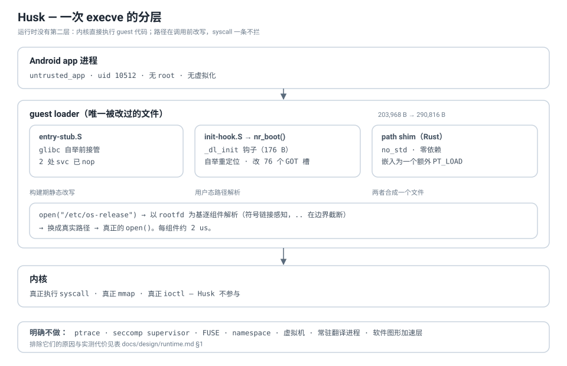

# 架构

> 目标只有一个：让 glibc 用户态跑在 Android 内核上，**运行时不多走任何一层**。
> 本文解释这句话怎么落地，以及每一层的边界在哪里。



## 1. 一次 `execve` 真正发生了什么

```
app 进程 (untrusted_app, uid 10512)
  │  产品壳要起一条命令
  ▼
guest loader  ← 这是我们唯一改过的文件（ld.so）
  ├─ 入口桩 entry-stub.S：在 glibc 自举之前接管控制流
  ├─ 静态 nop 掉的 2 个 svc 调用点（set_robust_list / rseq）
  ├─ _dl_init 钩子（init-hook.S）：
  │     mprotect 自己的可写窗口 → 调 nr_boot()
  ├─ nr_boot()（Rust）：自举重定位 → 解析 12 个 import →
  │     遍历每个对象的 .rela.dyn/.rela.plt，把 76 个名字的 GOT 槽改成本地实现
  ├─ 构造函数、main
  ▼
内核  ← 只在这里执行 syscall。我们一条都不拦。
```

`nr_boot()` 做的就是 `LD_PRELOAD` 手工版：一次 GOT 改写，发生在任何构造函数之前，
之后每次 `open("foo")` 都是一条普通 `svc` 直达内核，参数里的路径在调用前已经被换成真实路径。

## 2. 为什么一定要进 loader

在 `untrusted_app` 域，`set_robust_list(99)` 与 `rseq(293)` 被 seccomp 判成
`SECCOMP_RET_TRAP`，而 glibc 是在 `__pthread_initialize_minimal_internal` 里调它们的——
**在 loader 内部，早于任何 preload 构造函数**。所以：

- 这两处 `svc` 只能构建期 `nop`；
- 用户态第一个能安全接管的点是 `_dl_init`（全部对象重定位完成、构造函数未跑）。

这也决定了不能靠 `LD_PRELOAD`：preload 对象在 `_dl_init` 之前就已经需要 libc 服务。

## 3. 三个改动点，全部构建期

| 改动 | 谁做 | 产物 |
|---|---|---|
| 追加一个 `R\|E` 的 `PT_LOAD`，把 shim 放进去 | `nr-tools embed` | `ld.so` 203,968 B → 290,816 B |
| `_dl_init` 上挂钩子（176 B，无重定位） | `init-hook.S` + `nr-tools embed` | 同一 `PT_LOAD` 内 |
| 2 处 `svc` → `nop` | `nr-tools scan-syscalls patch` | 字节级改写 |

`scan-syscalls` **不带偏移表**：它读镜像的 `.gnu.version_d` 自检 glibc 版本，按
`mov x8, #N; svc #0` 模式定位，并断言"后继指令只写 x0、不读 x0"（证明返回值被忽略）。
版本不符 / 数量不符 / 调用点消失 / 后继读 x0，四种情况一律拒绝写文件。

## 4. 路径解析（唯一有成本的环节）

```
open("/etc/os-release")
  → guest 绝对路径 → 以 rootfd 为基、逐组件解析
  → 每个组件送一次 realpath 风格查找（符号链接感知）
  → `..` 在 root 边界截断（不能逃出 rootfs）
  → 重组真实路径 → 交给真正的 open()
```

成本：**每走一个组件约 2 us**（父 fd + 名字的 `fstatat` 链）。实测见
[RESULTS](RESULTS.md)：单组件 5.4 us vs 同机真实路径 2.9 us。

优化的方向（未做）：以 `(父 fd, 名字)` 为键的解析缓存，目标是 1–2 us。

`execve` 特殊：认出 `PT_INTERP` 是动态解释器就改走同一个 loader，于是**子进程天然带 shim**，
不需要任何环境变量或包装脚本。

## 5. 76 个介入名，为什么不是 45

libc 自己的代码大量走私有别名：`__open64_nocancel`、`__gen_tempname` 内部的 `open` 等，
GOT 补丁看不见。所以除 POSIX 入口外还补了：

- stdio 入口 `fopen` / `creat`
- `realpath` / `canonicalize_file_name`
- `dlopen`
- `posix_spawn` / `eaccess`
- `_FORTIFY_SOURCE=3` 生成的 `__*_chk` 与 `*64` 孪生

每条都能指到触发它的具体程序（`docs/design/evidence/16`）。

## 6. 已知绕过与缺口（诚实清单）

| 缺口 | 原因 | 影响 |
|---|---|---|
| `execl/execle/execlp` | glibc 内部走私有 `execve`，无 PLT 槽；C 变参在稳定版 Rust 里定义不了；汇编蹦床会被 rustc 的 cdylib 导出表本地化 | 这两类调用路径不被重写，子进程拿不到 shim |
| `freopen` / `glob` / `nftw` / `dlmopen` | 未覆盖 | 少数程序路径解析走宿主 |
| `posix_spawn` 用 `fork` 而非 `vfork` | 实现选择 | 多一次页表拷贝 |
| 16K 页内核 | 未测 | 只保证 4K 页 |

## 7. 明确不做

不 ptrace、不 seccomp supervisor、不 FUSE、不 namespace、不虚拟机、不常驻翻译进程、
不做图形/硬件的软件加速层。

`runtime/crates/capability-probe` 里出现的 `ptrace`/`unshare`/`mount` 是**诊断探针**，
只回答"这台机器允许什么"，运行时路径里一行都不参与。
