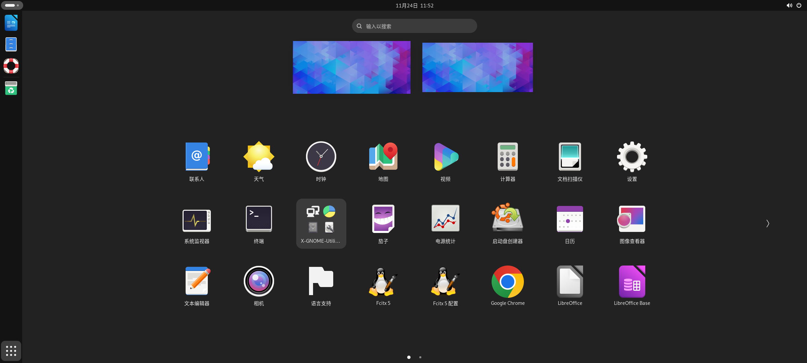
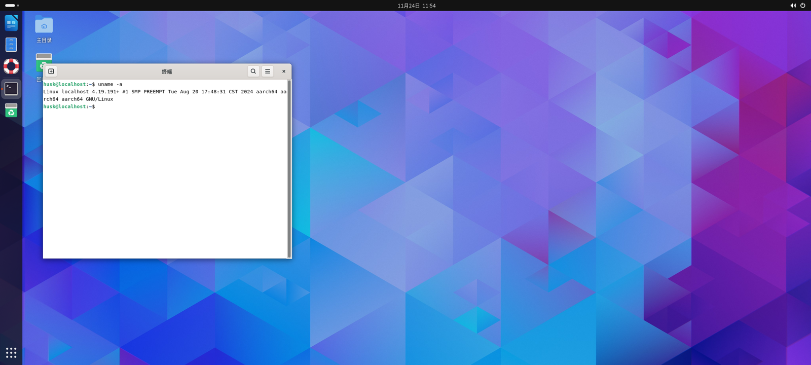

# 148 · 桌面收得到输入了：trackpad 语义、点击落在光标处（FACT）

日期 2026-11-24 · 设备 RMX3357（MT6893 / Android 13 / kernel 4.19.191 / 4KiB）
包 `com.linuxhub.myth.husk`（debug + `.husk` 后缀），会话全程 `untrusted_app`。

## 0 · 先纠正 evidence 147 §8 的错误结论

147 §8 当时写的是"桌面收不到输入，`X11Runtime` 没有任何注入指针或键盘的入口"。
**这是错的**，代码和实测都不支持：

- 上游输入链路一直连着。`app/src/main/java/com/java/myapplication/X11Screens.kt:527`
  创建 `LorieView` 之后立刻构造 `EmbeddedInputController(hostActivity, view)`，
  再 `runtime.bindView(view, hostActivity)` / `connectBoundView()` /
  `markInputControllerReady(true)`；`LorieX11Runtime.bindView()`（`:567`）与
  `connectBoundView()`（`:603`）把 `TouchInputHandler` 装到 view 上。
- 被删掉的只是 termux-x11 自己的 `MainActivity` / `LoriePreferences` 两个 Activity，
  `LorieView` 与 `input/` 整棵树（`EmbeddedInputController` 72 行、
  `TouchInputHandler` 1184 行、`InputEventSender` 265 行）都还在，也还在被用。
- 事件通路：`View.OnTouchListener` → `TouchInputHandler` → `InputStrategyInterface`
  → `InputEventSender` → JNI（`lorie/activity.c:332 sendTouchEvent` / `sendMouseEvent`）
  → 写进 `conn_fd` → 同进程的 Lorie X server → XI2 → mutter。

真正的问题是**语义**：`touchMode` 默认 `"1"` = Trackpad（`arrays.xml`：
1 Trackpad / 2 Simulated touchscreen / 3 Direct touch），而设备
`shared_prefs/com.linuxhub.myth.husk_preferences.xml` 里根本没有 `touchMode`
条目，于是走默认值。trackpad 语义下，**单指点按是"在光标当前位置按下"，
不会把光标挪到手指按下的地方**——这正是"点哪都没反应"的全部原因。

## 1 · 实测：trackpad 模式（`touchMode=1`）整条链路是通的（FACT）

全部用 `adb shell input ...` 注入真实 `MotionEvent`，从 App UI 看结果：

| 动作 | 注入 | 结果 |
|---|---|---|
| 单指拖动 = 移动光标 | `input swipe 1600 700 700 400 600` | 光标从右下角移到屏幕中部，画面重绘 |
| 光标悬停到 dock | `input swipe 1200 400 760 1000 700` | 光标停在"显示应用"图标上，**tooltip「显示应用」弹出** |
| 点按 = 在当前光标处点击 | `input tap 1200 300` | **应用网格打开**（见 `148-app-grid-open.png`） |
| 点击图标 = 启动程序 | 同上，指针在「终端」上再 tap | **终端窗口出现，出 bash 提示符**（见 `148-terminal-uname.png`） |
| 键盘 | `input text "uname%s-a"` + `KEYCODE_ENTER` | 终端里跑出 `Linux localhost 4.19.191+ #1 SMP PREEMPT Tue Aug 20 17:48:31 CST 2024 aarch64 aarch64 GNU/Linux` |

也就是说：**输入（触摸/鼠标/键盘）与输出（渲染）都正常**，
`gnome-shell` / DING / dock / GTK 窗口全部响应。




## 2 · 实测：`touchMode=2`（Simulated touchscreen）点击不落地（FACT，未修）

按 147 §8 的猜测把 prefs 改成 `touchMode=2` 后重启整个 App（桌面重建）：

- 手指/`input tap` 会**把光标挪到按下点**（说明坐标映射与事件通路都对）；
- 但**没有产生点击**：在 dock「显示应用」图标上连点两次，应用网格都不开。

`SimulatedTouchInputStrategy.onTap()` 用的是 `mRenderData.getCursorPosition()`
而不是事件坐标，按下点与点击点的落点由上一次 move 决定；具体为什么连点不生效
还没查（UNKNOWN）。**结论：这台机器上能用的模式是 `1`；`2` 需要修；`3` 未测。**

## 3 · 复现

```sh
# 桌面已在屏上（evidence 147）
adb shell input swipe 1200 400 760 1000 700     # 光标移到 dock
adb exec-out screencap -p > s1.png               # 可见 tooltip
adb shell input tap 1200 300                     # 在光标处点击
adb exec-out screencap -p > s2.png               # 应用网格已打开
adb shell input tap 1200 300                     # 再点（指针在「终端」上）
adb shell input text "uname%s-a"; adb shell input keyevent 66
adb exec-out screencap -p > s3.png               # 终端输出
```

`input tap/swipe/text` 走的是 Android 的真实事件注入，会命中
`MainActivity` 当前的 `LorieView`，等价于手指/键盘。

## 4 · 产品口径（JUDGMENT）

- 手机上的默认值不该是 trackpad：要用户先"摸黑拖动找到光标"才知道能点。
  但今天先不要把默认值改成 2——它是坏的（§2）。
- 顺序：先修 `2`（点击落点用事件坐标并在 DOWN 时就注入，而不是只依赖光标位置），
  或直接测 `3`（`NullInputStrategy` → 真 XI2 touch，mutter/GTK 原生处理），
  再把默认值改成能用的那个，trackpad 作为"精确指针"选项留着手动开。
