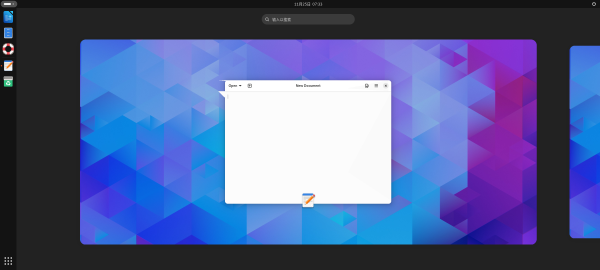

# 176 · 真实 GTK4 客户端在 zink/PanVK 的 X11 上跑通了

日期：2026-11-25 07:33（CST）。设备 RMX3357（MT6893 / Mali-G77 MC9 / Android 13），
应用 `com.linuxhub.myth.husk`，X server `:0`（X.Org 21.1.99，2400×1080）。

这条补的是 `LIMITATIONS` §7 里一直挂着的那句话：「还没验的是**普通应用**：GTK4 的 ngl 渲染器
这类真实客户端没跑过，遇到花屏/黑窗口先怀疑这里」。

## 做法

1. 独立 DBus 会话总线（`$R/tmp/xdg-gtk4/bus`），`XDG_RUNTIME_DIR` 指到同一目录；
2. `GDK_BACKEND=x11`、`GSK_RENDERER=ngl`（GTK4 4.14 的 GL 渲染器，不指定也会默认它）；
3. zink/PanVK 那套环境（`GALLIUM_DRIVER=zink`、`MESA_LOADER_DRIVER_OVERRIDE=zink`、
   `VK_ICD_FILENAMES=…/husk_panvk_frist370_execva.json`、`MESA_GLES_VERSION_OVERRIDE=3.2`），
   经 `xe-drmfd.sh`（`libld-drmfd.so`，带假 DRM 节点）启动 `usr/bin/gnome-text-editor`；
4. 12 秒后看 `xwininfo -root -tree` 与 X 根窗口像素（`gl-probe root` 抓 PPM）。

## 结果（FACT）

- 窗口真的建起来了：`0x1200004 "New Document (Draft) - Text Editor": ("gnome-text-editor" …) 822x642+120+-21`；
  同屏还有 `mutter-x11-frames`、`Desktop Icons 1`（gjs）——桌面会话也在跑。
- X 根窗口 2400×1080 抓图：**28 565 种颜色**，主色 `#222222`（GNOME 窗口底）、`#FCFCFC`（正文），
  采样非黑比例 1.000。截图里能看清侧边 dock 图标、顶栏时钟、壁纸渐变、文本框光标——
  不是黑窗口、不是"有窗口没内容"、不是花屏。
- 日志里 `FristOneRR 1.2.0 (Mesa 26.3.0-devel)`、`panvk is not a conformant Vulkan implementation`
  说明这一进程确实走了 PanVK（GTK 的 ngl 渲染器 → GL → zink → Vulkan → kbase）。

## 同时暴露的三件事

| 日志 | 判读 |
|---|---|
| `DRI3 error: Could not get DRI3 device` | 预期内，见 evidence 174：X server 在应用进程里、没有 DRM 设备 |
| `libGL: unknown device attribute: device_name`（`drirc.d/00-msm-defaults.conf`） | 装饰性告警：Mesa 的 drirc 里有它不认的键，不影响渲染 |
| `kbase: KBASE_IOCTL_MEM_EXEC_INIT failed: EPERM (executable BO allocation will not work)` | **UNKNOWN**：内核拒绝可执行 BO，但渲染仍然正常（着色器走的是别的路径）。没查清之前不写"已解决" |

## 不能说明什么

- 只验了一个 GTK4 应用（`gnome-text-editor`）。WebKit（`libwebkitgtk-6.0` 在树里）和 Electron
  这类重客户端**没测**；
- 没有输入交互测试（点击/键入的延迟与正确性），也没有长时间开着看是否泄漏；
- 呈现仍是每窗口一次回读+拷贝（evidence 174），这一条不因为"能出画面"而改变。
