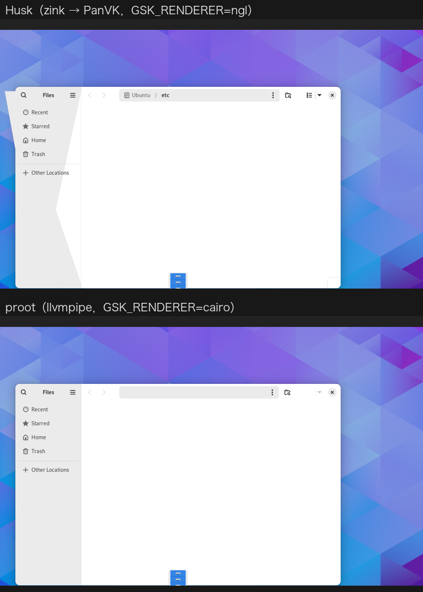

# 178 · Nautilus 开窗与枚举都正常，内容区整块空白（proot 同样）

日期：2026-11-25 07:50（CST）。设备 RMX3357（MT6893 / Mali-G77 MC9 / Android 13），
应用 `com.linuxhub.myth.husk`，X server `:0`（X.Org 21.1.99，2400×1080），
rootfs `distributions/ubuntu-24.04/rootfs`（Nautilus 46）。

这条补的是 evidence 176 留下的那句话：那轮只验了 `gnome-text-editor` 一个 GTK4 客户端，
`LIMITATIONS` §7 里写着「WebKit/Electron 类没测」。现在补测文件管理器，结论是**坏的**，
而且坏在整条桌面栈上，不是坏在 path-shim 上。

## 做法

1. 独立 DBus 会话总线（`$R/tmp/xdg-gtk4/bus`）、`XDG_RUNTIME_DIR` 指到同一目录；
2. `GDK_BACKEND=x11`、`GSK_RENDERER=ngl`、zink/PanVK 那套环境，经 `xe-drmfd.sh`
   （`libld-drmfd.so`，带假 DRM 节点）启动 `usr/bin/nautilus --new-window /etc`；
3. 开 `G_MESSAGES_DEBUG=all` 看它在干什么；`xdotool` 移窗口、清场；
4. `xwininfo -root -tree` 取窗口几何，`gl-probe root` 抓 X 根窗口 PPM。

对照组用同一份 rootfs、同一个 X server，换 **proot** 起：
`proot --link2symlink -0 -r <rootfs>`，`GALLIUM_DRIVER=llvmpipe`、`GSK_RENDERER=cairo`。

## 结果（FACT）

| 项 | Husk（zink→PanVK，ngl） | proot（llvmpipe，cairo） |
|---|---|---|
| 开窗 | `0xe00004 "etc" (org.gnome.Nautilus) 1012x672` | 同样 1012x672 |
| 面包屑 | `Ubuntu / etc` 正常显示 | 只剩一个空灰条，**文字没画出来** |
| 侧栏 / 工具栏 | 正常 | 正常 |
| 内容区 | **整块空白**（连列头都不出现） | **整块空白** |

补充实测：

- **枚举是好的**。`G_MESSAGES_DEBUG=all` 里逐条打印 `nautilus-file-DEBUG: file:///etc/group`、
  `…/gshadow`、`…/perl`、`…/passwd`……，`nautilus-view-DEBUG: Files added in window 0x…: file:///etc`。
  不是"没读到目录"。
- **不是渲染后端**。同一台机上 `GSK_RENDERER=cairo` 重跑，内容区照样空白。
- **不是视图模式**。`org.gnome.nautilus.preferences default-folder-viewer` 在 `list-view` 和
  `icon-view` 下都试过，两种视图都空白。
- **不是 shim**。同一份 rootfs 换 proot 起（完全不经过 Husk 的 loader / path-shim），
  内容区一样空白；proot 那侧反而更差（面包屑文字也没了，`dconf-WARNING: failed to commit
  changes: The connection is closed`）。
- **文件层没问题**（在 shim 里量）：`ls /usr/share` 194 项、`gio list /usr/share` 194 项；
  用 GTK 自己的 `GtkDirectoryList`（`monitored` 开与不开）直接读 `/usr/share`，都是
  `loading=False n=194 err=None`。
- **同一会话里别的 GTK4 客户端是好的**：
  - `gnome-control-center`（GTK 4 + libadwaita）1102×762，侧栏条目、`AdwStatusPage` 的大图标
    和「Network Unavailable / Error details: NetworkManager not running.」全画出来了；
  - `gnome-text-editor`（evidence 176）；
  - 自写的 22 行最小程序：`GtkColumnView` + `Gtk.StringList` + `GtkLabel`，表头 `Name` 和
    `alpha`/`beta`/`gamma`/`delta`/`epsilon` 五行**全部正常显示**。
- **配置值不空**：`org.gnome.nautilus.list-view default-visible-columns` 是
  `['name', 'size', 'date_modified']`，`default-column-order` 14 项齐全。

## 判读

内容区空白**不是** Husk 独有的：它在 proot 下同样出现，而同一会话里其他 GTK4 客户端
（含最小 `GtkColumnView`）都能画。所以问题落在 Nautilus 这个地方——它的视图单元、
`NautilusFile` 图标/信息通路、或它对会话服务的依赖——而不是落在 syscall 直通或路径改写上。

**根因：UNKNOWN。** 已排除的假设：目录枚举失败（否，194 项）、渲染后端（否，cairo 同样）、
视图模式（否，两种都空白）、path-shim（否，proot 同样）、缺列配置（否，配置齐全）。
没排除的：Nautilus 自己的 cell/factory 与 `NautilusFile` 信息通路、gvfs peer-to-peer 回退到
会话总线后的行为、以 root 运行时的降级路径（每次启动都会打
`This app cannot work correctly if run as root`）。这三条都**没验**。

## 不能说明什么

- 不能说明「所有 GTK4 应用都画不出来」——反例已经在上面（g-c-c、text-editor、最小
  `GtkColumnView`）；
- 不能说明 Husk 的呈现链没问题：evidence 174 那笔每帧回读 + 拷贝的代价照旧存在；
- 只测了一个文件管理器、两个目录（`/etc`、`/usr/share`），没有输入交互（点击进子目录、
  双击打开文件）。
