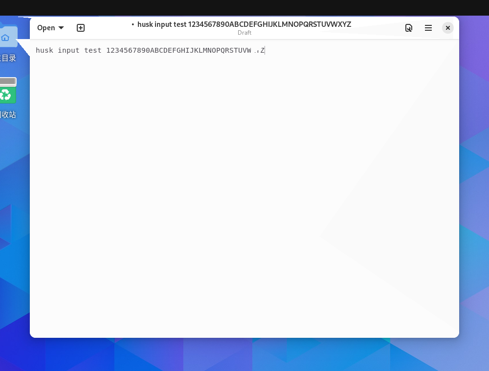

# 180 · 键盘事件能进 guest 的 GTK4 客户端并真的改画面

日期：2026-11-25 07:58（CST）。设备 RMX3357（MT6893 / Mali-G77 MC9 / Android 13），
应用 `com.linuxhub.myth.husk`，X server `:0`（2400×1080），rootfs Ubuntu 24.04。

`LIMITATIONS` §7 里一直挂着「输入交互**未测**」。这条把它补掉——测的是**键盘**，
指针注入另见 evidence 148。

## 做法

1. `gnome-text-editor`（GTK 4.14，`GSK_RENDERER=ngl`，zink/PanVK）按 evidence 176 那套环境起来；
2. `xdotool mousemove 700 300` + `click 1` 把焦点点到正文，再 `xdotool type --delay 60
   "husk input test 1234567890ABCDEFGHIJKLMNOPQRSTUVWXYZ"`（走 XTEST，不是往窗口里塞假事件）；
3. 敲完等 3 秒，`gl-probe root` 抓 X 根窗口。

## 结果（FACT）

- 标题栏变成 `husk input test 1234567890ABCDEFGHIJKLMNOPQRSTUVWXYZ`（GTK 自己按未保存修改
  改的标题），说明事件链 **X server → GTK → 缓冲区 → 重绘** 整条都通了；
- 正文第一行画出 `husk input test 1234567890ABCDEFGHIJKLMNOPQRSTUVW` 并在右边界折行，
  第二个字母串的尾巴接在下一行——折行、光标、文本裁剪都正常；
- 把窗口从 822×642 改成 1000×780 触发一次全量重绘，内容与改之前一致，没有花屏、没有残影。

一个**判读**（INFERENCE，不是 FACT）：第一轮抓图（敲字后等 4 秒）正文只画到一半，第二轮
（又敲 26 个字符、等 3 秒）是完整的。差异符合「`--delay 60` × 27 字符 ≈ 1.6 秒，抓图和
敲字并发」，也就是**抓早了**；没有证据说明是丢帧或增量重绘丢失。

## 不能说明什么

- **没量延迟**：只证明事件到得了、画得出，没有测「按下到屏幕上出现」的时间；
- 没测组合键、输入法（IME）、触摸（指针另见 evidence 148）、长按重复；
- 只测了一个 GTK4 客户端，没测 Electron/WebKit 类。
