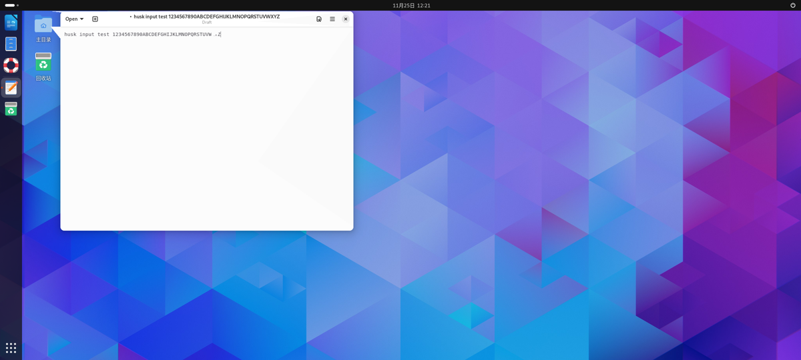
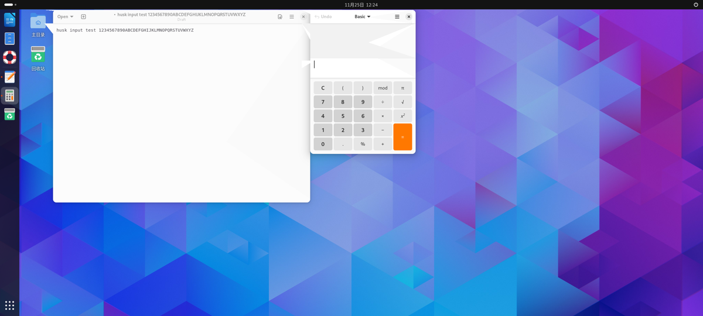

# 184 · 「安全模式、主题全丢了」的真根因：GTK 侧全是原厂默认（Adwaita），外壳是 Yaru

日期：2026-11-25 12:18–12:26（CST）。设备 RMX3357（MT6893 / Mali-G77 MC9 / Android 13），
应用 `com.linuxhub.myth.husk`，会话由 2.0 侧拉起（`gnome-shell --x11 --replace
--mode=linuxhub-ubuntu-min`），X server `:0`。

## 1 · 现象（用户报的，不是猜的）

进桌面后「像安全模式」「主题全丢了」、窗口也不对齐。这次先把「主题」这一半查到底。

同一会话里两个窗口并排：



- 左边 `gnome-text-editor`：标题栏与正文是**Adwaita**（GNOME 原厂）；
- 左侧 dock、壁纸、顶栏是 **Yaru**（Ubuntu 的）。

也就是「外壳是 Ubuntu、窗口是白板」——不是主题文件丢了，是**两套默认值来自不同的地方**。

## 2 · 实测（FACT）

| 项 | 值 |
|---|---|
| `gnome-shell` cmdline | `…/usr/bin/gnome-shell --x11 --replace --mode=linuxhub-ubuntu-min` |
| 该 mode 的 json | `stylesheetName: Yaru/gnome-shell.css`、`themeResourceName: theme/Yaru/gnome-shell-theme.gresource`（与 `ubuntu.json` 内容基本一致） |
| shell 进程 maps | `…/theme/Yaru/gnome-shell-theme.gresource`、`…/theme/Yaru/gnome-shell-icons.gresource` **已映射** → shell 主题确实加载了 |
| `/usr/share/themes` | `Adwaita Adwaita-dark Default Emacs Raleigh Yaru Yaru-blue … Yaru-xhdpi`（Yaru 齐） |
| 已装包 | `yaru-theme-gtk`、`yaru-theme-icon`、`fonts-ubuntu`、`gnome-session`、`gnome-settings-daemon` 都 installed |
| **没装** | **`ubuntu-settings`**（提供 Ubuntu 外观 gschema 默认值的那个包） |
| `gsettings get org.gnome.desktop.interface gtk-theme` | `'Adwaita'` |
| `… icon-theme` / `cursor-theme` | `'Adwaita'` / `'Adwaita'` |
| `… font-name` | `'Cantarell 11'` |
| `… color-scheme` | `'default'` |
| 会话里的 gsd | 只有 3 个：`gsd-color`、`gsd-media-keys`、`gsd-xsettings`（正常 Ubuntu 会话十几个） |
| shell 的渲染环境 | `GALLIUM_DRIVER=llvmpipe`、`MESA_LOADER_DRIVER_OVERRIDE=swrast` → **这个会话是软件渲染** |

## 3 · 根因（两条，都不是"缺文件"）

1. **Ubuntu 的 GTK 外观不是靠主题文件自动生效的**，是 `ubuntu-settings` 用 gschema override 把
   `gtk-theme/icon-theme/cursor-theme/font-name/color-scheme` 钉到 Yaru 上。这个 rootfs 没有
   那个包（Yaru 主题文件反而齐），于是所有 GTK 程序拿到 GNOME 原厂默认，而 gnome-shell 因为
   session mode 里写死了 stylesheet 仍是 Yaru —— 于是夹生。
2. **会话只起了 3 个 gsd**（`gnome-session` 装了却没跑），所以电源/声音/键盘/鼠标/剪贴板这些
   `org.gnome.SettingsDaemon.*` 服务都不在。这一条属于 **2.0 侧的会话组合方式**，不在本仓库。

## 4 · 修法（运行时层，不碰 2.0 代码）

安装器写 `/usr/share/glib-2.0/schemas/99-husk-look.gschema.override`
（`tools/guest-config/husk-look.override`：Yaru / Yaru / Yaru / `Ubuntu 11` / `prefer-light` /
`24h` / `appmenu:minimize,maximize,close`），然后用 guest 自己的 `glib-compile-schemas`
重新编译 schema。这只是**默认值**：用户或程序自己 set 过的键永远优先。

实测（同一台机、同一棵树）：

```text
$ env … usr/bin/glib-compile-schemas /usr/share/glib-2.0/schemas
rc=0
$ gsettings get org.gnome.desktop.interface gtk-theme   → 'Yaru'
$ gsettings get org.gnome.desktop.interface font-name   → 'Ubuntu 11'
```

改完之后**新起**的 GTK 程序直接是 Yaru（计算器的 `=` 键是 Ubuntu 橙、按钮圆角）：



老窗口仍是旧的（GTK 在启动时读一次主题），重开会话即统一。

## 5 · 顺手查出来的两个真 bug

1. `/usr/lib/aarch64-linux-gnu/libpxbackend-1.0.so` **不在默认库路径上**（它在
   `usr/lib/aarch64-linux-gnu/libproxy/` 里），`glib-networking` 的 gio 模块
   `libgiolibproxy.so` 每次初始化都刷
   `Failed to load module: …/libgiolibproxy.so` + `libpxbackend-1.0.so: cannot open shared
   object file`。不影响出画，但**每次 gio 初始化都刷日志**，代理支持也就是坏的。未修。
2. 会话是 **llvmpipe 软件渲染**：2.0 侧把 `GALLIUM_DRIVER=llvmpipe` /
   `MESA_LOADER_DRIVER_OVERRIDE=swrast` 写死在启动环境里了。加载器**不会**覆盖程序自己设的
   变量（这是对的），所以要改的是 app 侧那一行。

## 6 · 不能说明什么

- 只验了「新起的 GTK 程序吃到 Yaru」与 gsettings 返回值，**没有**重开会话看整体视觉；
- gsd 缺 9 个导致的行为（电源、声音、键盘布局、剪贴板）**没测**；
- 窗口拖动/对齐是另一个问题（`docs/LIMITATIONS.md` §8 输入一行），本文件不涉及。
