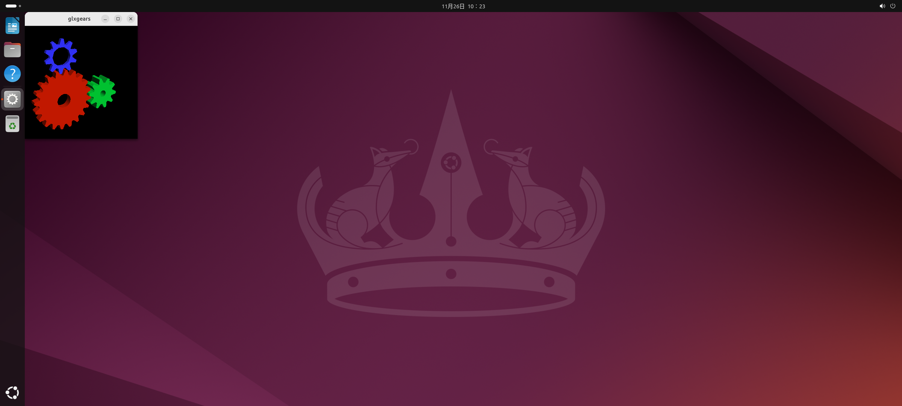

# 245 · 真实 X11 下的硬件 Zink/PanVK：60 秒通过，当前 2.0 会话仍是软件环境

日期：2026-11-26 10:20–10:36（CST）。设备 RMX3357 / Android 13 / kernel 4.19.191 /
4 KiB 页 / Mali-G77 MC9。测试对象是现有 2.0 包 `com.linuxhub.myth.husk` 的 X server（`:0`）；
没有修改 2.0 源码或数据。

## 1 · 结论

| 项 | 结果 | 证据等级 |
|---|---|---|
| guest 内 `glxinfo -B` 能否走真实 GPU | `Accelerated: yes`，renderer 为 `zink Vulkan 1.3(Mali-G77 MC9 (MESA_PANVK))` | FACT，真机 |
| 真实 X11 窗口里的 `glxgears` | 60 秒内持续出帧，11 个 5 秒窗口为 232–268 FPS；退出码 124 是外部 `timeout` 到点 | FACT，真机 |
| 真实 X11 窗口里的 `glxgears` 长跑 | 600 秒内 119 个 5 秒窗口，147872 帧，215.779–299.303 FPS，平均 248.352 FPS；没有崩溃 | FACT，真机 |
| 当前由 2.0 拉起的 GNOME 会话是否吃 GPU | **否**：进程环境是 `llvmpipe` + `swrast` + `LIBGL_ALWAYS_SOFTWARE=1` | FACT，真机 |
| 当前会话的呈现计数 | 约 1.0–1.2 FPS，`0/0 present copies offloaded to GPU` | FACT，真机 |
| 修完 2.0 启动环境后的桌面 GPU 表现 | 未验证；这不在 Husk 仓库里 | UNKNOWN |
| X11 窗口呈现是否已经是零拷贝 | 否；窗口内容进入 X server 仍是 SHM 回读/拷贝 | FACT，见 evidence 228 |

结论要分开写：**Husk 的 guest → X11 → EGL/GLX → Zink → PanVK 这条硬件路径已经能从真实窗口稳定出帧；
但当前 2.0 启动的 GNOME 进程被显式钉在软件渲染，所以不能把这次 `glxgears` 说成“桌面已经全局 GPU”。**



## 2 · `glxinfo -B`（FACT）

命令在 guest rootfs 里执行，显式设置 `DISPLAY=:0`、Zink/PanVK 和当前 loader：

```text
MESA: warning: kbase: KBASE_IOCTL_MEM_EXEC_INIT failed: Operation not permitted (executable BO allocation will not work)
WARNING: panvk is not a conformant Vulkan implementation, testing use only.
name of display: :0
display: :0  screen: 0
direct rendering: Yes
Extended renderer info (GLX_MESA_query_renderer):
    Vendor: Mesa (0x13b5)
    Device: zink Vulkan 1.3(Mali-G77 MC9 (MESA_PANVK)) (0x90800011)
    Version: 27.0.0
    Accelerated: yes
OpenGL renderer string: zink Vulkan 1.3(Mali-G77 MC9 (MESA_PANVK))
OpenGL version string: 2.1 Mesa 27.0.0-devel (git-b84f02a451)
OpenGL ES profile version string: OpenGL ES 3.2 Mesa 27.0.0-devel (git-b84f02a451)
```

`KBASE_IOCTL_MEM_EXEC_INIT` 的 EPERM 警告仍然存在；Mesa 继续走非可执行 BO 路径，本轮没有把它写成已修。

运行中的 `glxgears` 进程也能直接看到真实节点和驱动映射：

```text
/proc/22282/fd/4 -> /dev/mali0
/proc/22282/fd/5 -> /dev/mali0
.../usr/lib/aarch64-linux-gnu/libvulkan_panfrost_x11.so
.../usr/lib/aarch64-linux-gnu/libGLX_mesa.so.0.0.0
```

这不是只看环境变量推断出来的“应该走 GPU”，而是进程确实持有 Mali 节点并加载了 PanVK/GLX 驱动。

## 3 · 60 秒真实窗口测试（FACT）

`glxgears -info` 在 2400×1080 的 X11 桌面上连续运行 60 秒，外部 `timeout` 到点后返回 124：

```text
GL_RENDERER   = zink Vulkan 1.3(Mali-G77 MC9 (MESA_PANVK))
GL_VERSION    = 2.1 Mesa 27.0.0-devel (git-b84f02a451)
1162 frames in 5.0 seconds = 232.376 FPS
1237 frames in 5.0 seconds = 247.349 FPS
1336 frames in 5.0 seconds = 266.916 FPS
1338 frames in 5.0 seconds = 267.586 FPS
1187 frames in 5.0 seconds = 237.049 FPS
1252 frames in 5.0 seconds = 250.314 FPS
1233 frames in 5.0 seconds = 246.541 FPS
1317 frames in 5.0 seconds = 263.311 FPS
1340 frames in 5.0 seconds = 267.728 FPS
1280 frames in 5.0 seconds = 256.000 FPS
1338 frames in 5.0 seconds = 267.554 FPS
FINAL_RC=124
```

这里的 232–268 FPS 是 `glxgears` 这个简单 fixed-function workload 的数字，不等于 GNOME 桌面、
浏览器、视频播放器或游戏都能达到同样帧率；它只证明窗口化 GLX 没有再走 llvmpipe。

## 4 · 600 秒长跑（FACT）

同一命令把外部 `timeout` 调到 600 秒，窗口持续刷新。设备侧日志保留了 119 个完整的 5 秒窗口：

```text
samples        = 119
frames_total   = 147872
fps_min        = 215.779
fps_max        = 299.303
fps_avg        = 248.352
renderer       = zink Vulkan 1.3(Mali-G77 MC9 (MESA_PANVK))
FINAL_RC       = 124
```

`FINAL_RC=124` 是 GNU `timeout` 按预期杀掉长时间运行的进程；日志末尾没有 `segv`、没有 `fa=0x21`、
没有 `SIGSEGV`。这个结果把旧的“真实 X11 `glxgears` 45 秒内 `RC=139`”从当前默认配置下复现失败，
但不能外推到所有 fixed-function 程序或 GNOME 桌面硬件会话。

## 5 · 为什么当前桌面仍是软件渲染（FACT + INFERENCE）

在它自己的 X server 上，2.0 拉起的 `gnome-shell` 进程环境为：

```text
DISPLAY=:0
DBUS_SESSION_BUS_ADDRESS=unix:abstract=linuxhub-session-bus-husk
GALLIUM_DRIVER=llvmpipe
MESA_LOADER_DRIVER_OVERRIDE=swrast
LIBGL_ALWAYS_SOFTWARE=1
```

同一会话的应用日志：

```text
5 frames in 5.0 seconds = 1.0 FPS, 0/0 present copies offloaded to GPU
6 frames in 5.0 seconds = 1.2 FPS, 0/0 present copies offloaded to GPU
```

2.0 的 session 脚本源码也把软件环境写进去了：

`/Users/l/Documents/Codex/2026-08-10/linuxhub/LinuxHub-2.0/rust/linuxhub-sessiond/src/scripts.rs:333`

```text
MESA_LOADER_DRIVER_OVERRIDE=swrast GALLIUM_DRIVER=llvmpipe LIBGL_ALWAYS_SOFTWARE=1
```

**FACT：** 实际运行环境确实是软件渲染。
**INFERENCE：** 当前桌面低帧率由这条显式软件环境与当前 X11 呈现路径共同造成；不能把它归因于
Husk loader 或 PanVK 探针。
**UNKNOWN：** 2.0 改成硬件会话后，GNOME 是否能稳定保持可接受帧率；这需要 2.0 侧修改后另行实测。

## 6 · 下一步

- Husk 侧：保持 loader 默认值只在程序没有显式设置时生效；不覆盖 2.0 的显式回退开关。
- 2.0 侧：桌面启动时不要无条件导出 `GALLIUM_DRIVER=llvmpipe`、
  `MESA_LOADER_DRIVER_OVERRIDE=swrast`、`LIBGL_ALWAYS_SOFTWARE=1`；至少提供硬件桌面模式并
  在失败时显式回退。
- 复测判据：新的 GNOME 进程环境应出现 Zink/PanVK；同一台机补硬件 GNOME 的 10 分钟桌面长跑、
  输入、应用并发和 `present copies offloaded to GPU` 计数。

## 7 · 边界

- 本次没有改 2.0 源码，也没有把当前软件桌面冒充成 GPU 桌面。
- `glxgears` 通过不等于端到端零拷贝；evidence 228 的 SHM/回读限制仍然成立。
- 600 秒只证明这个单窗口 fixed-function workload；其他 fixed-function 程序、硬件 GNOME、
  多应用并发、其他 Mali GPU、Adreno/KGSL 真机仍是 UNKNOWN。

## 8 · 构建与门禁

`make check` 通过：fmt、目标架构 `cargo check`、主机侧 `gpu-env` 单测、Clippy、69 个 shell
脚本、270 个 Markdown 链接和 `VERSION=0.0.20` 一致性全部通过。

`make gate-a` 在同机通过：`PASS=38 FAIL=0`。后续 coverage-probe 也通过，实测覆盖
`unlink`、`remove(3)`、`inotify_add_watch`、`inotify` 事件、`freopen`、`pathconf`、
`truncate64`、`utime(3)` 和 `scandirat`；raw `openat` 仍按已知边界绕过 shim。coverage-sweep
因 rootfs 中没有 `strace` 按既定规则记为 `SKIP`，不冒充通过。

`make test` 在本机没有通过，原因是 macOS 上的 `cc`/`ld` 不认识
`--fix-cortex-a53-843419`、`--as-needed`、`-Bstatic` 等 aarch64 Linux 链接参数。这个 target
的注释本来就写明需要 arm64 Linux 主机；因此本次不把 `make test` 记为通过，也不伪造测试结果。
`glxgears` 和 `glxinfo` 的真机结果不依赖这一步。

本次发行包：

```text
dist/husk-arm64.tar.gz  size=7127418
sha256=53157bd7c7668063a9b5af31fe9136ff284bec01444c38b189f4e086714d4d20

dist/SHA256SUMS         size=84
sha256=cb5012c5c37fd65eae0a91ffce3a32572b1157b4efcbd877cfa9986ecacac223

loader sha256=020ab832e69e1aaadfe81219006636fc21347558a0e56b599e166a2240515c7c
```
